# Sports Scoreboard

A static, responsive sports scoreboard dashboard powered by ESPN's public site API. It is designed to run from a normal static web host, including Home Assistant's `config/www` directory, without a backend server or production Node.js runtime.

## Features

- College Football, NFL, MLB, NBA, and NHL scoreboard tabs
- TV Lineup view with network rows, estimated game windows, and live scores/status
- Standings view for each supported league, showing ESPN-provided groupings and statistics
- Football week and season-type controls
- Calendar date selection for MLB, NBA, and NHL
- Live, upcoming, and completed game views
- Automatic scoreboard refresh every 15 seconds
- Game detail modal with scores, team statistics, scoring plays, drives, and win probability when supplied by ESPN
- Clickable team names that open team information, records, statistics, and schedule
- Customizable sport tabs, including visibility and ordering
- Multiple favorite teams per league, highlighted by ESPN team ID
- Browser-local preference persistence for favorite teams and sport settings
- Defensive handling for missing logos, scores, dates, records, and partial ESPN responses
- Static deployment with relative JavaScript module paths

## Browser CORS Limitation

ESPN's browser CORS behavior has been inconsistent since October 2026, particularly for team-detail and schedule requests. A static browser deployment, including Home Assistant, cannot work around a server's CORS policy; those requests may fail even while scoreboard data continues to load. The [native wrapper](https://github.com/RyanMorrisroe/SportsScoreboard-Native) routes ESPN JSON requests through its allowlisted Tauri command instead. Check the browser console and network panel when diagnosing direct-browser failures.

## Screenshots

Desktop images are full-page browser captures. Mobile images are captured at Pixel 9a resolution (1081 x 2404 pixels, approximately 412 x 916 CSS pixels).

### Scoreboard

| Desktop                                                        | Pixel 9a                                                          |
| -------------------------------------------------------------- | ----------------------------------------------------------------- |
| 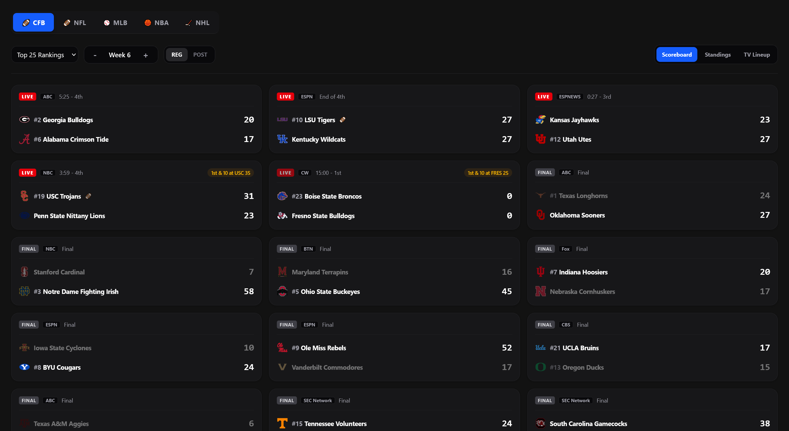 | 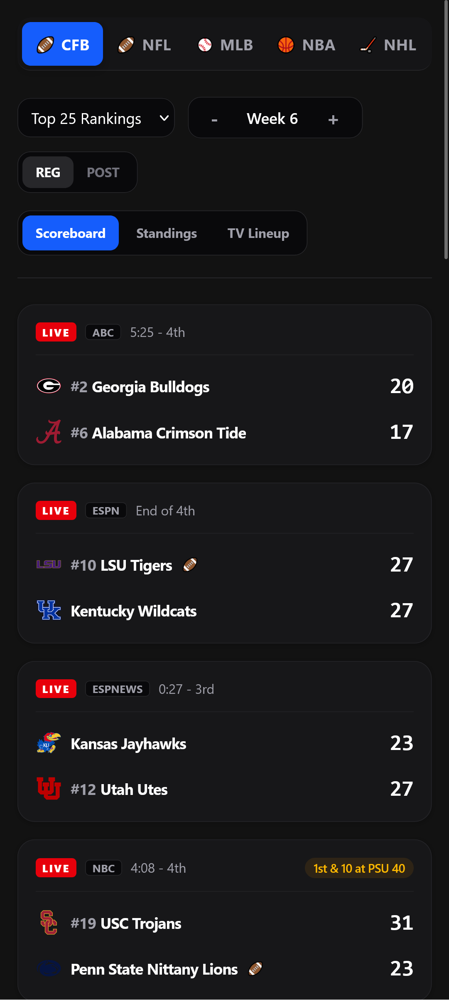 |

### TV Lineup

| Desktop                                                        | Pixel 9a                                                          |
| -------------------------------------------------------------- | ----------------------------------------------------------------- |
| 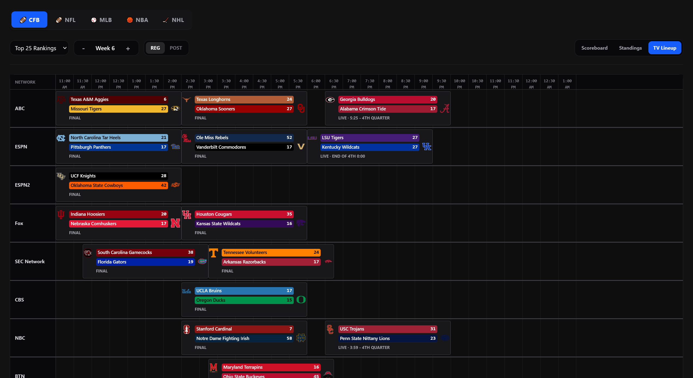 | 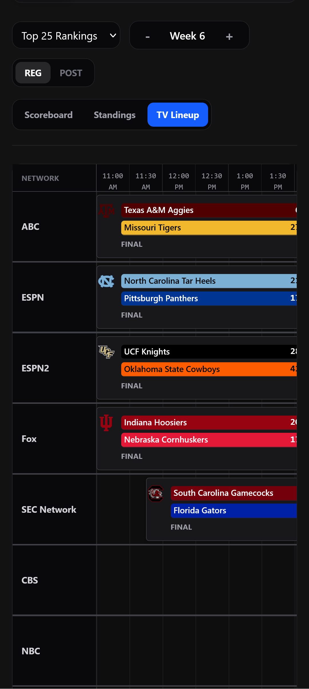 |

### Standings

| Desktop                                                      | Pixel 9a                                                        |
| ------------------------------------------------------------ | --------------------------------------------------------------- |
| 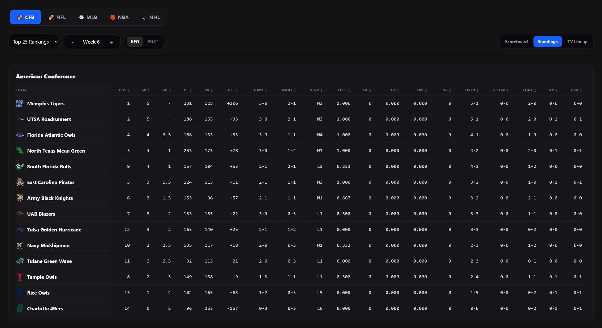 | 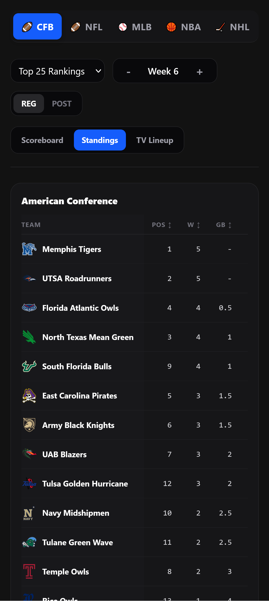 |

### Hockey Scoreboard

| Desktop                                                                      | Pixel 9a                                                                        |
| ---------------------------------------------------------------------------- | ------------------------------------------------------------------------------- |
| 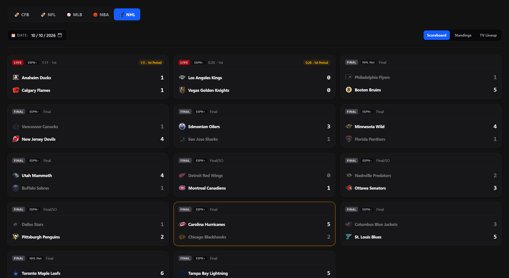 | 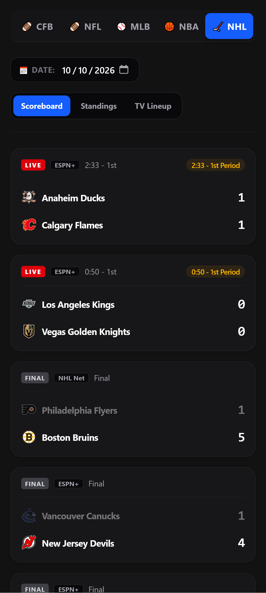 |

### Game Details

| Desktop                                                                | Pixel 9a                                                                  |
| ---------------------------------------------------------------------- | ------------------------------------------------------------------------- |
| 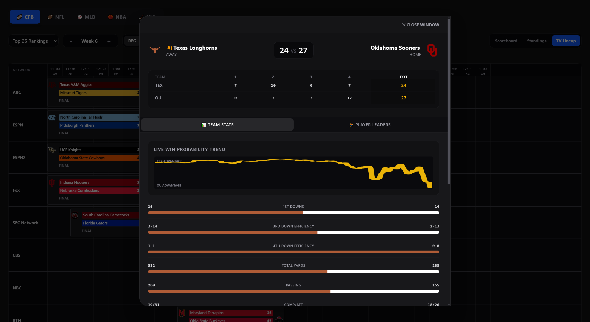 | 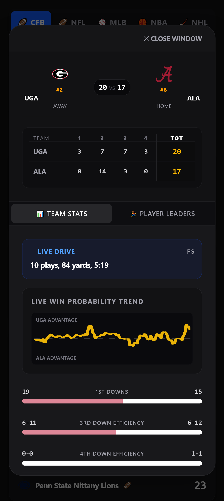 |

### Team Details

| Desktop                                                                | Pixel 9a                                                                  |
| ---------------------------------------------------------------------- | ------------------------------------------------------------------------- |
| 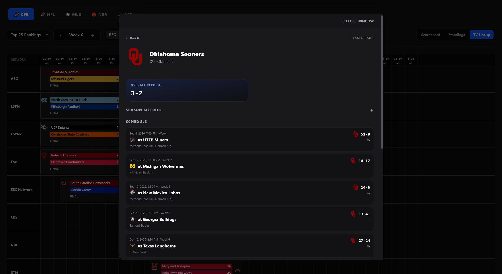 | 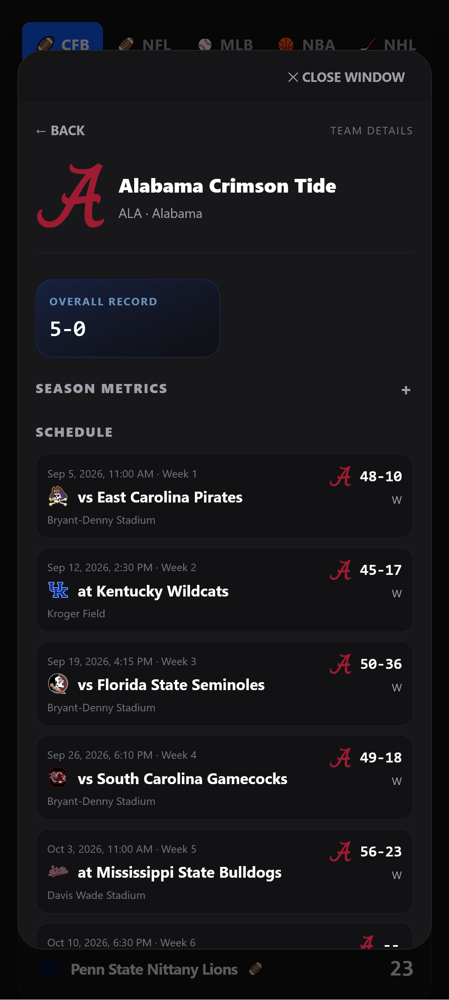 |

## How It Works

The application is a Vue 3 single-page app. Vite compiles its component templates and bundles the frontend into static files.

- Vue 3 and Tailwind CSS are installed locally and included in the production bundle.
- Application code, the Vue script, Vite configuration, and tests are TypeScript. `tsconfig.json` enables strict checking; the production build runs `vue-tsc` before tests and bundling.
- The SPA calls ESPN directly with `fetch` in a browser. When hosted inside Tauri, the same API adapter uses Tauri IPC to call the native ESPN proxy.
- ESPN payloads enter through an `unknown` boundary and are normalized by typed domain modules.
- League behavior is composed from shared defaults, sport-family defaults, and league-specific overrides in `src/plugins/`. The current registry contains College Football, NFL, MLB, NBA, and NHL.
- The static browser build has no backend, database, production Node.js runtime, or runtime configuration service. The native Tauri wrapper optionally supplies the ESPN proxy over IPC.

The application currently builds ESPN endpoints using these patterns:

```text
Scoreboard:
https://site.api.espn.com/apis/site/v2/sports/{sport}/{league}/scoreboard

Game summary:
https://site.api.espn.com/apis/site/v2/sports/{sport}/{league}/summary?event={eventId}

Team details:
https://site.api.espn.com/apis/site/v2/sports/{sport}/{league}/teams/{teamId}

Team schedule:
https://site.api.espn.com/apis/site/v2/sports/{sport}/{league}/teams/{teamId}/schedule

Standings:
https://site.api.espn.com/apis/v2/sports/{sport}/{league}/standings
```

College Football and NFL use the `football` sport path. MLB uses `baseball`, NBA uses `basketball`, and NHL uses `hockey`. Date-based leagues send the selected date as `dates=YYYYMMDD`; football uses week and season-type parameters.
Standings use ESPN's v2 Site API endpoint, whose response contains league-specific groups and team statistics. ESPN may expose additional levels through a `group` query parameter; the app follows group IDs from the response to load those levels and renders the resulting hierarchy without assuming each sport uses the same conference or division structure.

## Project Structure

```text
index.html                         Vite HTML entry point
src/App.vue                        Vue UI and TypeScript component setup
src/main.ts                        Vue mount entry point
src/styles.css                     Tailwind import and global styles
src/api/espn.ts                    Typed ESPN URLs and fetch wrappers
src/domain/*.ts                    Game, team, schedule, matchup, standings, and play-by-play normalizers
src/composables/*.ts               Typed Vue state and workflow composables
src/plugins/                       Shared, family, and league-specific behavior contracts
src/app/*.ts                       League lookup, preferences, history, scoreboard, and game-flow helpers
scripts/build.mjs                  Vite production build and license packaging
vite.config.ts                     Vite, Vue, and Tailwind build configuration
tsconfig.json                      Strict TypeScript configuration
tests/unit/*.test.ts               Unit tests
tests/integration/*.test.ts        Fixture-backed integration tests
tests/fixtures/espn/               Trimmed ESPN response fixtures
tests/live/*.test.ts               Live ESPN smoke tests
.github/workflows/build.yml        Pull request and push build workflow
.github/workflows/espn-live.yml    Scheduled/manual live API workflow
.github/workflows/release.yml      Version-tagged release workflow
```

## Requirements

For development and builds:

- Node.js 20 or newer
- npm
- Network access for the browser to reach the ESPN API

Home Assistant only needs to serve the generated static files. It does not need Node.js.

## Install

From the project root:

```bash
npm ci
```

Use `npm install` only when intentionally updating dependencies or the lockfile.

## Test

Run all discovered tests:

```bash
npm test
```

Run strict TypeScript checking independently:

```bash
npm run typecheck
```

Vitest's default discovery includes unit tests, fixture-backed integration tests, and the live ESPN smoke test. The live test makes real requests and requires network access. For deterministic unit and fixture-backed integration tests only, run:

```bash
npx vitest run tests/unit tests/integration
```

Run all discovered tests with coverage (including the live smoke test):

```bash
npm run test:coverage
```

Start Vitest in watch mode while developing:

```bash
npm run test:watch
```

### Live ESPN Smoke Test

The live smoke test calls the real ESPN endpoints and validates the response shape and normalizer behavior. It uses NFL team `12` by default and can be configured with environment variables. It is included in `npm test` and `npm run test:coverage` because Vitest discovers all `*.test.ts` files by default; `npm run test:live` runs only this directory.

```bash
npm run test:live
```

PowerShell example:

```powershell
$env:ESPN_LEAGUE = "nfl"
$env:ESPN_TEAM_ID = "12"
npm run test:live
```

The live test is intentionally separate from the deterministic fixture tests. ESPN availability, rate limits, and changing sports data can cause a live test to fail even when the application code is correct.

## Build

Create the deployable static package:

```bash
npm run build
```

The build runs strict TypeScript checking and `npm test` before creating `dist/`. Since the default test command includes the live smoke test, building requires network access. The generated package contains:

- `index.html`
- `assets/` containing bundled JavaScript and CSS
- `LICENSE`

The browser loads no Vue, Tailwind, or application modules from a CDN or from `src/` at runtime. `dist/` is ignored by Git because it is generated output.

To develop locally, start the Vite server over HTTP (it remains in the foreground until stopped):

```bash
npm run serve
```

Then open `http://localhost:8000`. Port 8000 is strict; stop an existing server using that port before starting Vite. To test the production output, run `npm run preview` after the build and open `http://localhost:4173`. Do not test by opening `index.html` with a `file:` URL.

## GitHub Actions

The repository includes three workflows.

### Build workflow

`.github/workflows/build.yml` runs on pushes and pull requests targeting `main`. It:

1. Installs the locked dependencies with `npm ci`.
2. Runs coverage, including the live ESPN smoke test discovered by Vitest.
3. Runs the test-gated static build.
4. Uploads `dist/` as a workflow artifact.

Configure the `Build / build` job as a required status check in branch protection for `main`.

### Live ESPN workflow

`.github/workflows/espn-live.yml` runs daily and supports manual dispatch from the Actions tab. It calls the real ESPN API using the configured default NFL team.

GitHub-hosted standard runners are free for public repositories. Artifact storage and retention are still subject to GitHub limits. The live workflow does not require secrets because the tested ESPN endpoints are public.

### Release workflow

`.github/workflows/release.yml` can be run manually from the Actions tab or triggered by pushing a semantic version tag matching `v*.*.*`. A manual run finds the latest semantic version tag and creates the next minor version (for example, `v1.0.0` becomes `v1.1.0`). It installs dependencies, runs the test-gated build, packages `dist/` as a ZIP file, and creates a GitHub Release with generated release notes.

The workflow requires `contents: write` permission so it can create the release. It does not require a personal access token or repository secret; `github.token` is supplied by GitHub Actions.

To release with the automatic minor version bump, run **Release** from the Actions tab. To publish a specific version manually, create and push its tag from the project root:

```bash
git tag v1.1.0
git push origin v1.1.0
```

The resulting release asset will be named like:

```text
sports-scoreboard-v1.1.0.zip
```

The release ZIP contains the generated `dist/` directory. For Home Assistant, extract the ZIP and copy the contents of `dist/` into a directory under `config/www`, as described below. Do not create a release from a pull request or ordinary branch push.

## Deploy To Home Assistant

Home Assistant serves static files from its `www` directory. The URL is normally available under `/local/`.

### Option 1: Build locally

1. Install Node.js and npm on a development machine.
2. From the project root, run:

   ```bash
   npm ci
   npm run build
   ```

3. Copy the contents of `dist/` into a directory under Home Assistant's `config/www`, for example:

   ```text
   /config/www/sports-scoreboard/
   ```

4. Open the dashboard at:

   ```text
   http://HOME_ASSISTANT_HOST:8123/local/sports-scoreboard/
   ```

   The exact URL depends on your Home Assistant host and whether authentication or a reverse proxy is in use.

5. Add the URL to Home Assistant using a panel or webpage card, for example:

   ```yaml
   type: iframe
   url: /local/sports-scoreboard/index.html
   aspect_ratio: 75%
   ```

### Option 2: Use the GitHub Actions artifact

1. Open a successful Build workflow run in GitHub.
2. Download the `sports-scoreboard-dist` artifact.
3. Extract it into:

   ```text
   /config/www/sports-scoreboard/
   ```

4. Reload the browser and open `/local/sports-scoreboard/`.

Copy the contents of `dist/` rather than the `dist/` directory itself if you want `index.html` directly at the deployment path.

### Option 3: Use a GitHub Release

1. Open the desired release in the repository's **Releases** page.
2. Download the `sports-scoreboard-vX.Y.Z.zip` asset.
3. Extract the ZIP and copy the contents of its `dist/` directory into:

   ```text
   /config/www/sports-scoreboard/
   ```

4. Reload the browser and open `/local/sports-scoreboard/`.

### Home Assistant Notes

- Home Assistant does not need Node.js after the files are deployed.
- Copy the complete contents of `dist/`, including the `assets/` directory, into the deployment directory. The generated asset URLs are relative so the SPA works beneath `/local/`.
- When updating, replace the deployed files together so `index.html` does not refer to missing hashed assets; remove stale assets if needed and hard refresh the browser.
- The browser must be able to make requests to ESPN. Network restrictions, content blockers, DNS filtering, or a restrictive proxy can prevent scoreboard data from loading.
- After updating files, perform a hard refresh if the browser appears to show an older version.

## Adding A League

To add another ESPN league:

1. Confirm the ESPN sport and league identifiers used by the Site API.
2. Add the league to the typed plugin registry in `src/plugins/registry.ts`, reusing its sport-family defaults and overriding only behavior that differs. `src/app/leagues.ts` derives the supported league list from this registry.
3. Update the league UI or controls only where the new schedule mode or behavior requires it; avoid duplicating shared views and logic.
4. Check scoreboard, summary, team, schedule, and standings response shapes, including optional and missing fields.
5. Add representative JSON fixtures and TypeScript unit/integration tests for routing, plugin composition, presentation, and normalization before enabling the league.
6. Run `npm run typecheck`, deterministic tests with `npx vitest run tests/unit tests/integration`, review `npm run test:coverage`, then run `npm run build` (which also runs the live smoke test).

The API, plugin, and normalizer modules are intentionally separated from the UI so sport-specific payload differences can be handled without introducing a backend.

## Troubleshooting

### No games appear

Check the browser developer console and network panel. Confirm the ESPN request succeeds and that the selected league, week, season type, or MLB date has games available.

### Team details do not load

Confirm that the game response includes a team ID and that the team and schedule endpoints are reachable. The team detail view makes two requests: one for details and one for schedule.

### Standings do not load

Check the browser developer console and network panel for the ESPN v2 standings request. ESPN may return different grouping hierarchies by league; if the payload has no team entries, the dashboard reports that standings are unavailable.

### The page works locally but not in Home Assistant

Serve the built package through an HTTP server, confirm the complete `dist/` contents were copied, and check that the `/local/` URL maps to the directory under `config/www`.

### Live tests fail in GitHub Actions

A failure may indicate an ESPN outage, rate limiting, a changed payload shape, or a changed team configuration. Run the live test locally, inspect the response, and compare it with the fixture-backed tests before changing application logic.

## Data Source And Disclaimer

This project uses ESPN's publicly accessible site API endpoints. It is not affiliated with or endorsed by ESPN. API availability, response formats, schedules, branding, and data may change without notice. Use the application within the terms and policies that apply to the data source.

## License

See [LICENSE](LICENSE).
